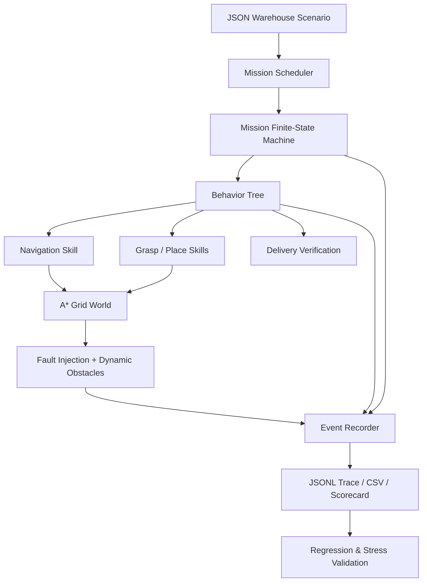

# Warehouse Robot Skill Orchestrator

**A Python-based warehouse robotics simulation for coordinating robot skills, managing mission states, planning grid-based routes, and validating task execution under injected failures.** No ROS2, Gazebo, GPU, physical robot, or external Python packages are required.

> **Scope:** This is a *discrete warehouse software simulation* that models skill sequencing, operational state, route planning, injected failures, and verification. It does **not** demonstrate robot kinematics, real grasp planning, perception, motor control, real physics, real-world navigation, or physical deployment. Simulation statistics do not predict hardware reliability.

## Why this project exists
This project explores how high-level warehouse tasks can be broken into smaller, testable robot skills. I used behavior trees to coordinate skill execution, a finite-state machine to track mission progress, and A\* pathfinding for grid navigation. The simulator lets me test retries, blocked routes, timeouts, and controlled failures without requiring physical robot hardware.

## Features

| Area | Concrete implementation |
| --- | --- |
| **Task orchestration** | Custom memory behavior-tree engine (`Sequence`, `Selector`, `Condition`, `Retry`, `Timeout`) coordinating navigation → grasp → transport → place → verify |
| **State control** | Explicit finite-state lifecycle with validated transitions: `PENDING → EXECUTING ↔ RECOVERING → SUCCEEDED/FAILED` |
| **Navigation logic** | A* grid planner with deterministic route selection and mid-mission replanning when a new obstacle invalidates the next step |
| **Fault tolerance** | Configurable retry policies, tick-based execution limits, reproducible skill-level fault injection, and low-battery safety checks |
| **Validation** | Machine-readable scenario definitions, tests for success and expected failure, exact deterministic replay |
| **Observability** | JSONL event trace, per-mission CSV, summary JSON, retry/replan/timeout counters, failure reasons |
| **Reliability experiments** | Repeatable seeded fault-injection stress runner with per-trial metrics and completion-rate scorecard |
| **CI** | GitHub Actions workflow runs Python test suite, scenario regression matrix, and fault-injection campaign |

## Quick start

Requires Python **3.10+**. Run commands from this repository's root folder.

```bash
# Run two warehouse missions with dynamic obstacles and injected failures
python -m warehouse_robot demo

# Run six positive and negative regression scenarios
python -m warehouse_robot suite

# Run deterministic 100-trial stress experiment (seed=42)
python -m warehouse_robot stress --trials 100 --seed 42 --fault-probability 0.2

# Run the automated tests, no packages to install
python -m unittest discover -s tests -v

# Run your own JSON task scenario
python -m warehouse_robot run scenarios/nominal.json --out output/custom
```

### Example demonstration 

```text
Warehouse pick-place: obstacles + transient actuator faults — PASS
  missions: 2 succeeded, 0 failed (100% completion)
  ticks: 33 | steps: 32 | retries: 3 | replans: 1 | injected faults: 3
    order-001: SUCCESS in 12 ticks
    order-002: SUCCESS in 21 ticks
```

The demo injects three transient skill failures, plus a dynamic blocked grid cell, while still completing both simulated pick-and-place missions. **A "tick" is a logical execution step, not elapsed time.**

### Example stress experiment (seed 42)

The seeded fault-injection campaign with 100 trials and 20% independent failure probability *per attempted skill invocation* completed both missions in **96 of 100 simulated trials**. This result is specific to the simplified scenario, fault model, and retry policy; **it is not an estimate of real robot reliability**.

## Architecture



### Behavior sequence

```text
MISSION START
   |
   v
CHECK STARTING BATTERY
   |
   v
NAVIGATE TO PICKUP ---[failure]--> RETRY (max 3)
   |
   v
GRASP OBJECT ---------[failure]--> RETRY (max 3)
   |
   v
NAVIGATE TO DROP ---[failure]--> RETRY (max 3)
   |
   v
PLACE OBJECT ---------[failure]--> RETRY (max 3)
   |
   v
VERIFY DELIVERY
   |
   +--> SUCCEEDED or FAILED (with structured reason)
```

## Scenario configuration

Each JSON scenario contains map dimensions, static obstacles, robot state, object locations, missions, optional timed obstacle additions, and per-skill injected failure attempts. Example:

```json
{
  "name": "Simple demonstration",
  "width": 6,
  "height": 4,
  "robot": {"location": [0, 0], "battery": 100},
  "obstacles": [[2, 0]],
  "objects": [{"id": "item-A", "location": [3, 1]}],
  "missions": [{"id": "job-1", "object_id": "item-A", "pickup": [3, 1], "dropoff": [5, 3]}],
  "faults": {"job-1:grasp": [1]},
  "obstacle_events": {"3": [[1, 1]]},
  "policy": {"max_ticks": 150, "nav_timeout_ticks": 35, "retry_budget": 3},
  "expected_successes": 1
}
```

Skill fault identifiers: `navigate_pickup`, `grasp`, `navigate_dropoff`, `place`.

## Scenario-based validation

| Scenario | Expected outcome | What it validates |
| --- | --- | --- |
| `nominal.json` | Success | Basic workflow and delivery verification |
| `demo_recovery.json` | Success | Dynamic obstacle replanning and multi-skill recovery |
| `timeout_recovery.json` | Success | Tick-based deadlines and resumable navigation |
| `fault_exhaustion.json` | Controlled failure | Retry budget enforcement and failure reporting |
| `unreachable.json` | Controlled failure | No-route handling without false success |
| `low_battery.json` | Controlled failure | Starting-battery gate |

`python -m warehouse_robot suite` checks *expected* outcomes, so intentional controlled failures count as passing regressions.

## Outputs

- `output/demo/summary.json` — completion, durations, counters, mission-level reasons.
- `output/demo/events.jsonl` — append-style structured events with tick, mission ID, action, and state transitions.
- `output/demo/missions.csv` — compact mission results and durations.
- `output/suite/regression_scorecard.json` — six scenario expectations vs. actual results.
- `output/stress/stress_scorecard.json` and `trial_metrics.csv` — reproducible trial-level stress data.

## Files

```text
warehouse_robot/
  model.py        # Typed robot/world/mission state + event recording
  tree.py         # Behavior tree composites and control-flow decorators
  lifecycle.py    # Finite-state mission lifecycle
  skills.py       # Navigate / Grasp / Place / Verify skill interface
  navigation.py   # A* pathfinding and grid detours
  scenario.py     # Scenario parsing and config validation
  engine.py       # Mission scheduler, recovery, reporting
  cli.py          # Demo, scenario suite, fault-injection stress runner
scenarios/        # Six positive and negative regression scenarios
tests/            # Unit and integration tests
.github/workflows/ci.yml
```

## Next steps

1. Add a real robot client interface (ROS2 Actions or vendor SDK) to replace discrete simulation skills.
2. Add object pose uncertainty, perception failures, grasp planning, and genuine collision checking.
3. Run real-time simulation with Gazebo before attempting a hardware validation plan.
4. Define deployment acceptance criteria informed by physical tests rather than simulation-only success rates.
